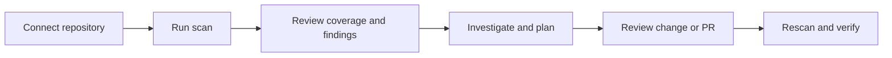
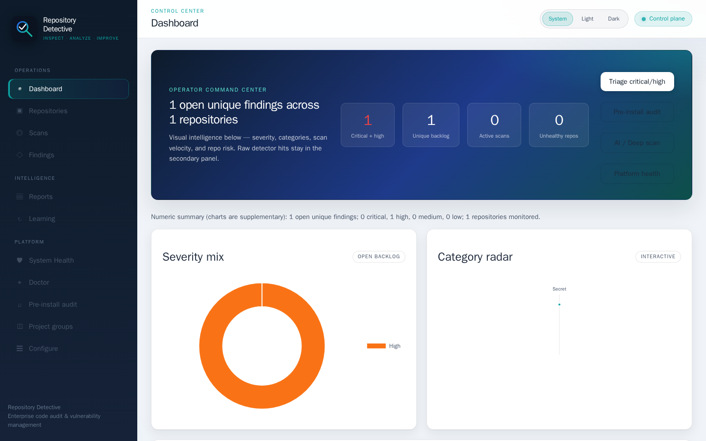
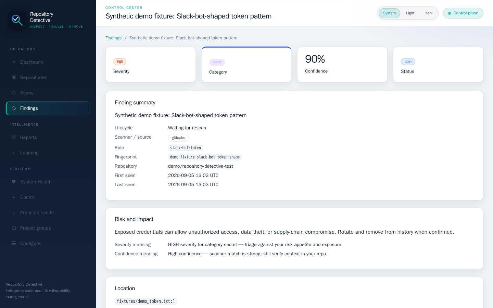
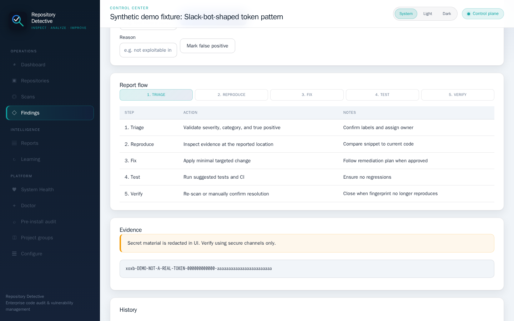

<p align="center">
  
</p>

<h1 align="center">Repository Detective</h1>
<p align="center"><strong>Find problems in your repositories. Understand the evidence. Make safer changes.</strong></p>
<p align="center">A self-hosted repository health and security workbench built primarily for Gitea maintainers.</p>

<p align="center">
  <a href="https://scanaislop.com/CommsTech/Repository-Detective" title="Third-party code-quality report (not a security certification)"></a>
</p>
<p align="center"><small>External code-quality signal · score methodology belongs to scanaislop · not a security attestation.</small></p>

<p align="center">
  <a href="docs/QUICKSTART.md">Get started</a> ·
  <a href="docs/DEMO.md">See the workflow</a> ·
  <a href="docs/README.md">Documentation</a> ·
  <a href="CHANGELOG.md">Changelog</a> ·
  <a href="SECURITY.md">Report a vulnerability</a> ·
  <a href="https://github.com/sponsors/CommsTech">Sponsor development</a>
</p>

---

Repository Detective brings security scanners, code-quality checks, evidence, and a remediation workflow into one interface. It helps teams answer four questions:

1. **What was found?** Locate vulnerabilities, exposed secrets, misconfigurations, reliability problems, and maintainability issues.
2. **Can I trust this result?** Inspect the source, affected revision, scanner outcomes, confidence, and missing coverage.
3. **What should I do next?** Prioritize findings, track issues, review proposed remediation plans, and choose a safe change.
4. **Did the fix work?** Review post-change scans and closure evidence instead of assuming that a PR or AI suggestion resolved the problem.

It is designed for people who maintain their own projects, small engineering/security teams, and operators of self-hosted forges. **You do not need to use AI to run the core scanner workflow.**

## What you get

| Capability | What it does |
|---|---|
| **Repository analysis** | Runs configured tools for dependencies, secrets, source code, containers, infrastructure configuration, and code quality. Actual coverage depends on installed scanners and the scan profile. |
| **Findings workbench** | Search, filter, prioritize, investigate, and track findings with source evidence and deduplication. |
| **Custom repository rules** | Add non-executable, version-controlled checks using [declarative rules](docs/CUSTOM_RULES.md), including a no-code builder. |
| **Forge integration** | Connect Gitea repositories, process webhooks, and optionally create and reconcile issues. Issue creation is **off by default**. |
| **Reports and SBOMs** | Inspect scanner outcomes, risk trends, audit limitations, and supported software bills of materials. |
| **Reviewable remediation** | Generate plans, review risks and suggested validation, and track eligible PR attempts. AI enrichment is optional and advisory. |
| **Policy and automation** | Configure Observe / Warn / Enforce policies, scan schedules, API access, and optional native workers. |

**Supported focus:** Gitea is the primary integration. Forgejo and GitHub integrations have narrower or unverified acceptance coverage; verify compatibility before relying on them in production. Repository Detective does **not** certify that a repository is vulnerability-free.

## A typical workflow



A scan completes only the **detection** phase. A proposed plan is not a patch; an opened PR is not a merged fix; a clean-looking result is not reliable if required scanners were skipped or failed.

## Quick start with Docker Compose

**Requirements:** Docker with Compose, a reachable Gitea server, and a Gitea token scoped to the repositories you want to scan. Review [system requirements and networking](docs/SETUP.md) before scanning untrusted code.

```bash
git clone https://github.com/CommsTech/Repository-Detective.git
cd Repository-Detective
cp .env.example .env

# Generate different values for both secrets:
openssl rand -hex 32   # REPOSITORY_DETECTIVE_API_KEY
openssl rand -hex 32   # REPOSITORY_DETECTIVE_SESSION_SECRET

# Edit .env: set those secrets, GITEA_URL, GITEA_TOKEN and WEBHOOK_SECRET.
# Keep AUTO_CREATE_ISSUES=false for your first report-only scan.
docker compose up -d --build
curl -f http://127.0.0.1:8081/health/ready
```

In `.env`, set `REPOSITORY_DETECTIVE_AUTH_MODE=local` and configure the variables `REPOSITORY_DETECTIVE_GITEA_URL`, `REPOSITORY_DETECTIVE_GITEA_TOKEN`, and `REPOSITORY_DETECTIVE_WEBHOOK_SECRET`. Generate a separate random webhook secret as well. Never commit `.env` or put an API key in a browser URL.

Open **http://127.0.0.1:8081/ui/bootstrap** to create the first operator, then sign in and follow the repository connection flow. Choose a repository, run a **report-only** scan, and check both the findings and scanner coverage. The first source build may take time because the image includes scanner tools.

The default Compose port is bound to **127.0.0.1**. See [Quickstart](docs/QUICKSTART.md) for published-image options, webhook setup, first scan by API, and LAN deployment precautions. For a pinned published image, follow [release verification](docs/VERIFY_RELEASE.md) rather than copying an old version tag from historical notes.

## See it in action

<p>
  <a href="docs/assets/screenshots/04-dashboard.png"></a>
  <a href="docs/assets/screenshots/05-finding-evidence.png"></a>
  <a href="docs/assets/screenshots/09-remediation-plan-preview.png"></a>
</p>

*Screenshots are illustrative demo captures and may differ from the current interface.* [More screenshots](docs/assets/screenshots/README.md) · [Demo walkthrough](docs/DEMO.md).

## AI, trust, and safety

- **Deterministic scanning comes first.** Optional local or external AI can explain findings and help prepare reviewable plans; AI-only opinions cannot silently suppress security findings.
- **Review before change.** Automated dependency upgrades and complete safe AI patch execution are **not verified end to end**. Remediation PR execution is disabled by default; Repository Detective never merges PRs automatically.
- **A runner is not automatically a sandbox.** Native workers are opt-in. Use a properly isolated environment for untrusted code; full forge Actions delegation and sandbox guarantees remain release gates.
- **Evidence has limits.** A policy pass means configured requirements were met, not that a repository is safe against every threat. Missing scanner coverage must stay visible.
- **Keep control of your data.** Local-model configurations are available; external forge access, notification delivery, or externally hosted models may still move information outside your network. Read [privacy modes](docs/PRIVACY_MODES.md).

For the precise boundaries, see [Security model](docs/SECURITY_MODEL.md), [runner operations](docs/RUNNERS.md), and [known limitations](docs/KNOWN_LIMITATIONS.md).

## Guides and reference

| I want to… | Start here |
|---|---|
| Install and scan a repository | [Quickstart](docs/QUICKSTART.md) · [Setup](docs/SETUP.md) |
| Understand a finding and prioritize work | [Operator triage workflow](docs/OPERATOR_TRIAGE_WORKFLOW.md) · [Finding ownership](docs/ISSUE_OWNERSHIP_AND_QUALITY_SIGNALS.md) |
| Review reports and supporting evidence | [Reports and navigation](docs/OPERATOR_REPORTS_AND_NAVIGATION.md) |
| Write repository-specific checks | [Custom rules](docs/CUSTOM_RULES.md) |
| Configure AI providers and budgets | [AI providers](docs/AI_PROVIDERS.md) |
| Integrate automation and tools | [API routes](docs/API_ROUTES.md) · [Configuration](docs/CONFIGURATION.md) |
| Run workers and evaluate isolation | [Runners](docs/RUNNERS.md) · [Security boundaries](docs/SECURITY_SANDBOX_AND_TRUST.md) |
| Verify a release or review outstanding gaps | [Release verification](docs/VERIFY_RELEASE.md) · [Current readiness](docs/release/CURRENT_PUBLIC_RELEASE_READINESS.md) |
| Review development history | [Changelog](CHANGELOG.md) · [Contributing](CONTRIBUTING.md) |

**Project source:** [Gitea](https://git.commsnet.org/commstech/Repository-Detective) (canonical) · [GitHub](https://github.com/CommsTech/Repository-Detective) (public mirror). The mirror may contain a sanitized history; see [mirror policy](docs/GITHUB_MIRROR.md).

**Feedback:** [Open a bug or feature request](https://github.com/CommsTech/Repository-Detective/issues/new/choose). For sensitive security reports, follow [SECURITY.md](SECURITY.md) rather than posting an exploit publicly.

**License:** [AGPL-3.0-or-later](LICENSE). Commercial terms: [Editions](docs/EDITIONS.md).
